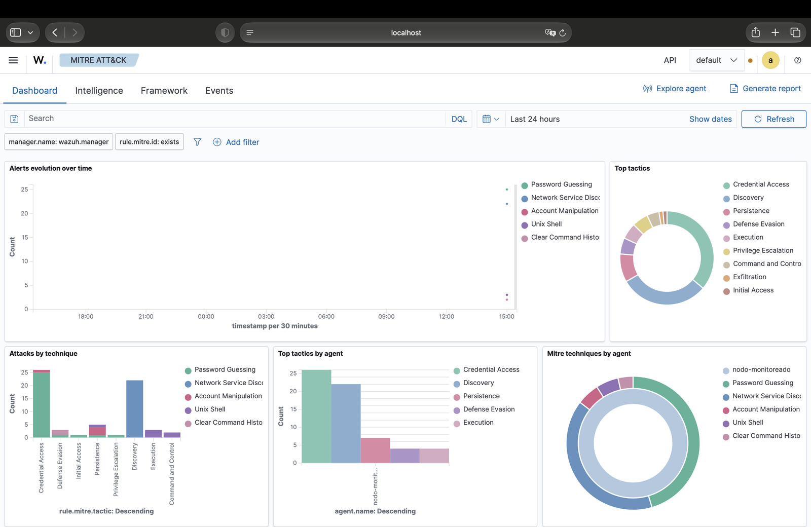
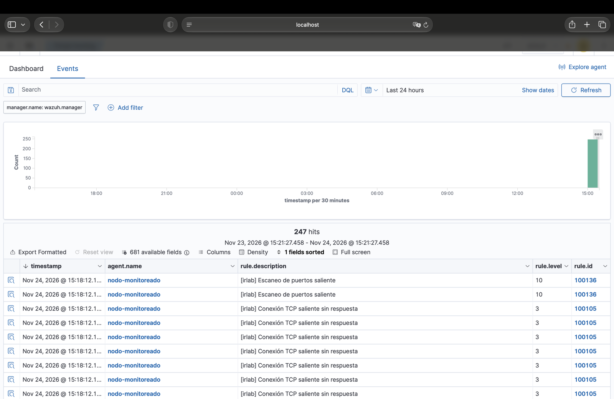

# incident-response-lab

[](https://github.com/inostroza-Daniela/incident-response-lab/actions/workflows/ci.yml)
[](LICENSE)
[](https://wazuh.com)
[]()

Laboratorio de **respuesta a incidentes como código** (blue team) sobre **Wazuh**.
Con un comando se levanta una red de laboratorio con un nodo monitoreado y un SIEM;
se corren simulaciones controladas que generan telemetría; el SIEM la detecta con
las reglas del [`detection-engineering-lab`](https://github.com/inostroza-Daniela/detection-engineering-lab);
y cada detección tiene un **playbook de respuesta** con la estructura de la ANCI.

Demuestra el ciclo completo de defensa: **detección → alerta → respuesta documentada**.
Es un entorno cerrado de defensa y aprendizaje, **no una herramienta ofensiva**.

> ⚠️ **Uso en laboratorio aislado.** Toda la actividad ocurre en una red interna
> de Docker sin salida a internet. Las credenciales son de ejemplo, solo para el
> lab. No usar contra sistemas de terceros ni en producción.

## El laboratorio en acción

El SIEM detectando las simulaciones y mapeándolas a **MITRE ATT&CK**:



Las reglas propias (`[irlab] ...`) disparando en tiempo real sobre la telemetría generada:



 **Recorrido en video** (qué es, para qué sirve y cómo funciona): [ver el video explicativo](docs/media/incident-response-lab.mp4).

## Arquitectura

```
                       red interna de Docker (internal)
  ┌──────────────┐   telemetría    ┌──────────────────┐  eventos  ┌───────────────┐
  │   operador   │────────────────▶│ nodo-monitoreado │──────────▶│ wazuh.manager │
  │  (irlab CLI) │ (vol. compartido)│  agente + auditd │           │  reglas irlab │
  └──────┬───────┘                 └──────────────────┘           └───────┬───────┘
         │  verifica alertas                                              │ indexa
         │  (vol. ro)                        ┌──────────────┐             ▼
         └──────────────────────────────────│   dashboard  │◀──── wazuh.indexer
                           127.0.0.1:8443 ──▶└──────────────┘
```

Detalle en [`docs/arquitectura.md`](docs/arquitectura.md). Todas las imágenes están
fijadas a **4.14.9**, la primera serie estable con imagen oficial `linux/arm64` del
manager, el indexer, el dashboard y el agente: la topología levanta igual en un Mac
Apple Silicon y en un host amd64.

## Puesta en marcha

```bash
cp .env.example .env
python3 scripts/obtener-reglas.py  # descarga las reglas del repo de detección
make certs                         # certificados internos (una sola vez)
make up                            # levanta la topología
make load-rules                    # convierte y carga las reglas en el manager
make simulate SIM=todas            # corre las simulaciones
make verify SIM=todas              # confirma las alertas
make report                        # informe + sitio (site/index.html)
```

Dashboard en `https://localhost:8443`. Guía completa en [`docs/uso.md`](docs/uso.md).

## Qué hace

- **Topología reproducible** (`docker-compose.yml`): stack Wazuh + nodo monitoreado
  con auditd + nodo operador, en red interna, con solo el dashboard en loopback.
- **Simulaciones** (`simulations/`): 13 generadores idempotentes y reversibles que
  reproducen, dentro del lab, los patrones que el repo de detección detecta. No son
  exploits: son generadores de telemetría, cada uno mapeado a su técnica ATT&CK.
- **Conversión de reglas** (`irlab convert`): las reglas Sigma del repo de detección
  se convierten a reglas locales de Wazuh de forma reproducible
  ([`docs/conversion-reglas.md`](docs/conversion-reglas.md)).
- **Playbooks** (`playbooks/`): uno por detección, con la estructura de la ANCI
  (detección, análisis/triaje, contención, erradicación, recuperación, lecciones).
- **Orquestación** (`Makefile` + CLI `irlab`): `up`, `down`, `load-rules`,
  `simulate`, `verify`, `report`.
- **Integración de vuelta**: la telemetría se exporta en el esquema del repo de
  detección (`irlab export`) para alimentar sus `samples/` sin conversión.

## Estructura

```
incident-response-lab/
├── docker-compose.yml        topología del laboratorio
├── config/                   configuración de Wazuh, auditd y del operador
├── src/irlab/                paquete: telemetría, conversión, orquestación, informe
├── simulations/              generadores de telemetría (uno por técnica)
├── playbooks/                respuesta ANCI, una por detección
├── scripts/obtener-reglas.py descarga las reglas Sigma (commit fijado)
├── tests/                    pruebas (se saltan las de Docker si no está)
└── docs/                     arquitectura, conversión de reglas, guía de uso
```

## Pruebas y calidad

```bash
pip install -e ".[dev]" && make lint && make test
```

Lint y formato con `ruff`, tipos con `mypy --strict`, pruebas con `pytest`. La
corrección de cada simulación se valida contra el motor del repo de detección, sin
depender de Docker.

## Ampliaciones futuras

- Soporte de Windows/Sysmon (hoy el laboratorio es Linux primero).
- Ejecución opcional de simulaciones benignas directamente sobre el nodo
  monitoreado para producir telemetría auditd nativa.
- Distribuir los timestamps de la telemetría en una ventana de tiempo realista.
  Hoy las simulaciones se corren en bloque y el manager fecha cada alerta con su
  hora de ingesta, así que las alertas quedan con una hora muy parecida; en un
  despliegue real llegarían a medida que ocurren los ataques.

## Reglas de detección

Las reglas Sigma se reutilizan del
[`detection-engineering-lab`](https://github.com/inostroza-Daniela/detection-engineering-lab)
(Detection Rule License 1.1). Este repo no las reescribe ni las versiona: las
descarga del commit fijado y las convierte. El código del laboratorio es MIT.
